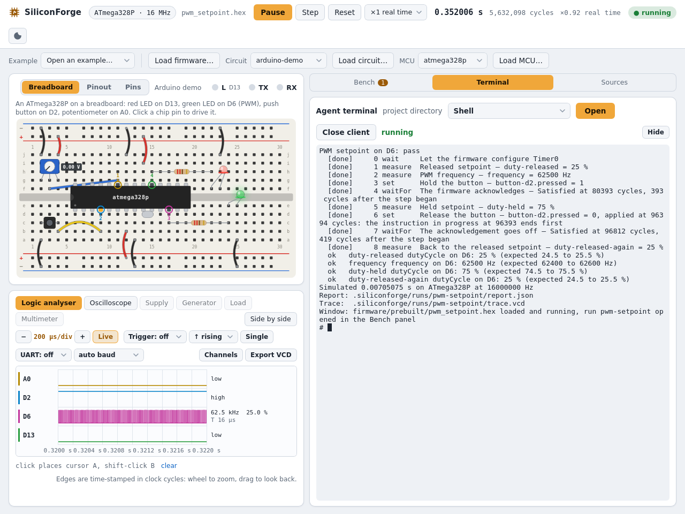
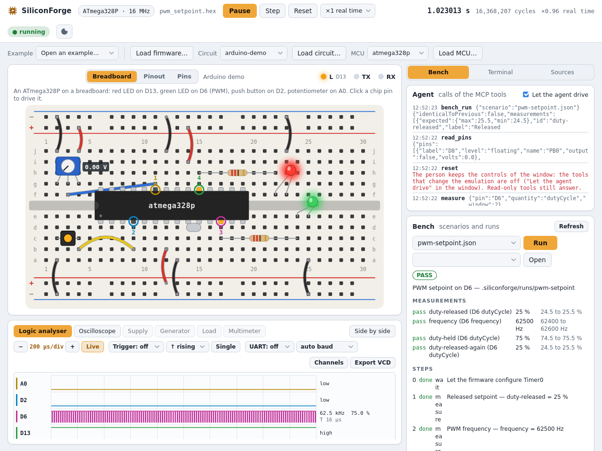
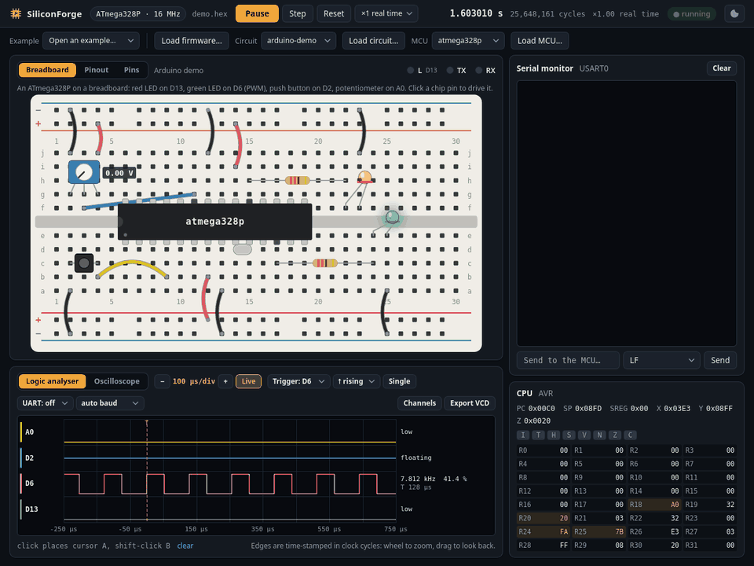
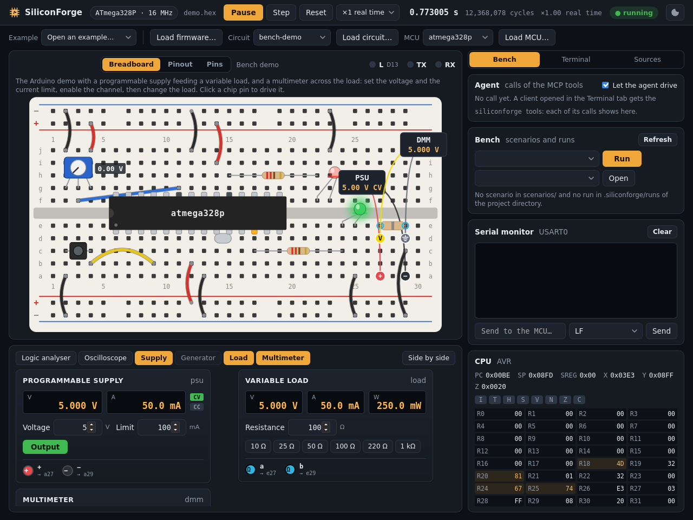
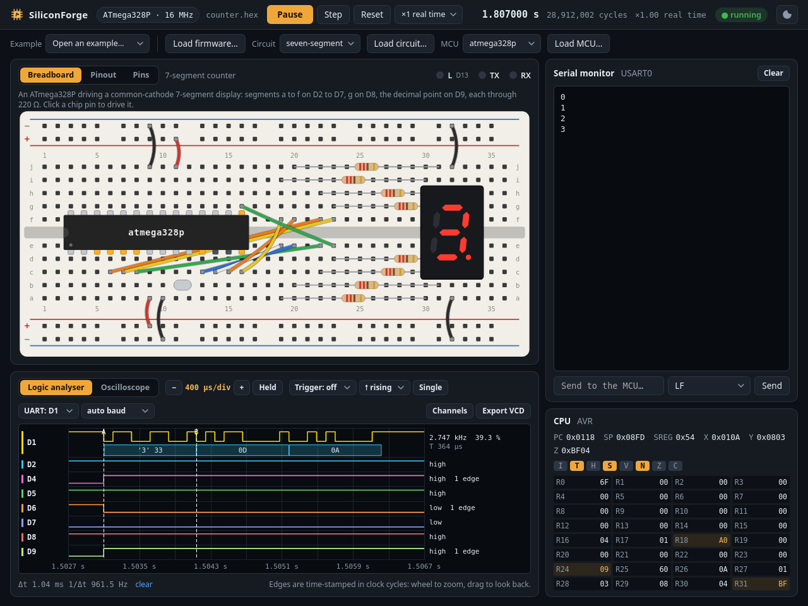
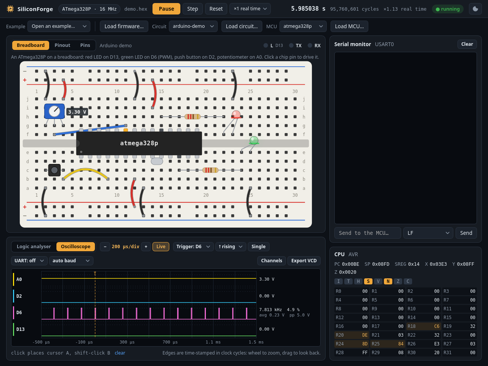
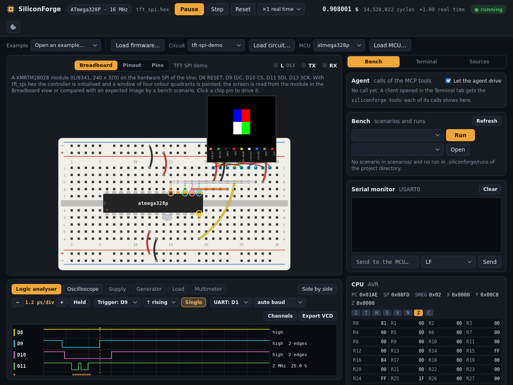
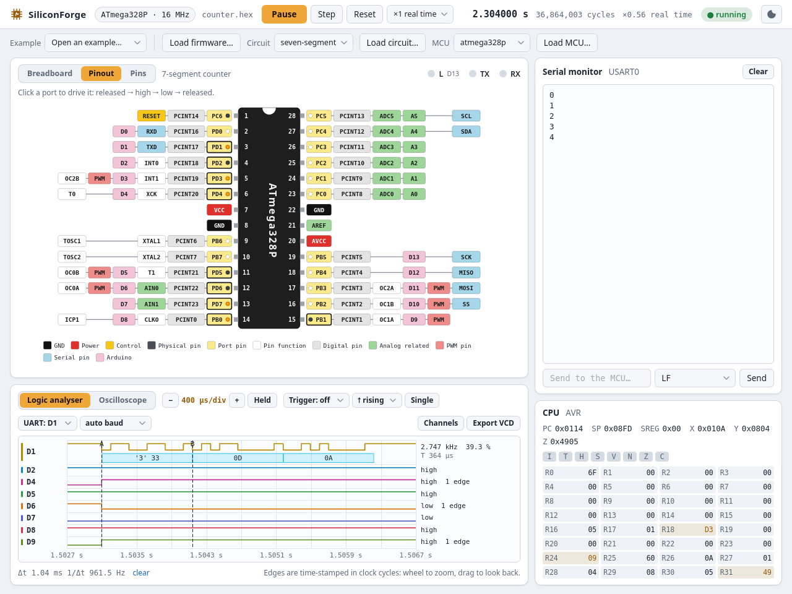

# SiliconForge

[Français](README.md) · English (UK)

**An Agentic Foundry for microcontrollers: the workshop where a coding agent produces, tests and fixes firmware and
the circuit around it.**

SiliconForge simulates a microcontroller cycle by cycle, together with its circuit and the instruments of an
electronics bench. You can use it on its own, as a simulator. Its main purpose, though, is to **close the loop of
agentic development on microcontrollers**. An agent such as Claude Code or OpenCode can write and compile a driver,
and then it hits the hardware. Someone has to flash the board, press the button, hook up the oscilloscope and read the
measurement. SiliconForge hands those actions to the agent: it loads the binary the agent has just compiled, operates
the circuit and measures the response. The agent gets a verdict it can act on, then fixes its code and tries again,
in front of you.

**A foundry, not an agent harness.** The agent's loop, the one that reasons, edits files and calls tools, stays
your client's: Claude Code, OpenCode, Codex or Mistral Vibe, with your subscription and your settings. SiliconForge
does not replace it. It brings what these clients lack to work on embedded systems: the board, the circuit, the
instruments and a reproducible verdict.

SiliconForge is a native, cross-platform application written in C++, for **macOS, Linux and Windows**.
The first supported microcontroller is the **16 MHz ATmega328P**, used in the Arduino Uno.

> **A demonstrator.** SiliconForge currently serves to understand how an Agentic Foundry is used and which features it
> must offer. See [next steps](#next-steps).

## Who does what

| | Role |
| --- | --- |
| **Your agent** | Reads the requirement, edits the firmware, builds it with the project's toolchain, interprets the verdict and decides on the fix |
| **SiliconForge** | Runs the binary on the simulated microcontroller, in its circuit. Applies the stimuli, measures to the cycle and returns a verdict with reproducible evidence (report, VCD trace, hashes of the inputs) |
| **You** | Follow every action on the board and the instruments, review the differences in the editor and take over at any time |

The agent has three ways into the bench, depending on how you work:

- **A scriptable command.** `siliconforge bench run scenario.json` runs a versioned test without a window. Its exit
  code tells success (0), a missed assertion (1) and an incompatible bench (2) apart. Two runs on the same inputs
  produce a report and a trace that are identical byte for byte.
- **MCP tools on the open window.** The client started in the window's terminal is given the `siliconforge` tools:
  `load_firmware`, `set_component`, `set_waveform`, `serial_send`, `read_pins`, `measure`, `bench_run`… They act on
  the emulation on screen. Every call is listed in the **Agent** log, and the **Let the agent drive** switch blocks
  everything that would change the emulation ([guide, French](docs/AGENT-MCP.md)).
- **A single workspace.** The right-hand column holds the **Terminal**, where your client runs, and the **Sources**,
  an editor that shows the Git differences of what the agent changed. The **Bench** panel shows the test runs,
  whether the agent or you started them.

### An example: a mistake only the bench reveals

The requirement asks for the PWM on D6 to be off while the button is released. The obvious fix, `OCR0A = 0`, is not
enough. In Fast PWM, the timer lets through a 62.5 ns pulse every period, just as on a real board. The bench measures
it, the agent reads it in the verdict and disconnects OC0A on the second attempt:

```console
$ siliconforge bench run scenarios/pwm-setpoint.json; echo $?
PWM setpoint on D6: fail
  FAIL duty-released dutyCycle on D6: 0.390625 % (expected 0 to 0.1 %)
  ok   duty-held dutyCycle on D6: 75 % (expected 74.5 to 75.5 %)
  ok   frequency frequency on D6: 62500 Hz (expected 62400 to 62600 Hz)
1
```

The full exercise, with and without the Foundry, and how to replay it are described in
[FOUNDRY.md](docs/FOUNDRY.md) (in French).





## Your code, a circuit, a visible result

The breadboard brings together a microcontroller and simulated components. Load the `.hex` or `.elf` binary produced
by your toolchain, or pick **Open an example…**. The `demo.hex` firmware, the one you would flash onto a board, blinks
the red LED on D13 and makes the green LED on D6 "breathe" with PWM. Meanwhile, the logic analyser shows the signal.



- **Watch your outputs.** The current of each LED is computed from the circuit (forward voltage, resistor), and a
  PWM-driven LED is lit the way the eye sees it. A TFT screen shows the pixels the firmware wrote.
- **Try your inputs.** Press a button, turn the potentiometer, click a pin to drive it, or inject a signal with the
  generator.
- **Talk to your code.** Send text to the microcontroller and read its replies in the serial monitor.
- **Investigate a problem.** Pause execution, inspect registers and then step through one instruction.
- **Spot a wiring mistake.** An output wired to a rail, two opposite outputs or an overloaded supply are reported.

## A complete bench

Every pin change is recorded with the clock cycle it happens on. The resolution is 62.5 ns at 16 MHz, with no
sampling and whatever the emulation speed. The bottom panel gathers the bench devices, one at a time or side by side:

- **Logic analyser and oscilloscope**: frequency and duty cycle, cursors, edge trigger, UART frame decoding, VCD
  export for GTKWave, PulseView or Surfer.
- **Laboratory power supply**: voltage setpoint, current limit, CV/CC indicators.
- **Variable load** and **multimeter**.
- **Signal generator**: sine, square, triangle or arbitrary waveform, with steps scheduled on the MCU clock.

See the [instruments guide](docs/INSTRUMENTS.md) (in French).







## TFT screens checked pixel by pixel

Two reference modules are simulated: the **KMRTM28028** (ILI9341, 240 × 320, SPI) and the **MCUFRIEND 3.5"** shield
(ILI9481, 320 × 480, 8-bit parallel bus). The decoder reads the pin levels to the cycle, so firmware using the
hardware SPI and firmware bit-banging the pins are decoded the same way. The panel can be dragged over the
breadboard, and each connector is labelled with the ATmega pin it is wired to.

A bench scenario compares the screen with a reference image in a `screen` step, so an agent can check that a display
driver draws what is expected. A screen that is off, asleep or without backlight stays black and fails the comparison
([format](docs/CIRCUITS.md#écrans-tft), [bench](docs/BANC.md#écran), in French).



## Change the circuit

A circuit is a JSON file describing the chip, the components plugged in the holes of the board and the wires.
Several circuits are provided: LEDs and a potentiometer, a 7-segment display, an LED and two buttons, a power bench,
a signal generator, SPI and parallel screens. Load your own with `--circuit circuit.json`, **Load circuit…** or drag
and drop.

The available components are the LED, the resistor, the push button, the potentiometer, the 7-segment display, the
crystal, the programmable supply, the variable load, the multimeter, the signal generator and the two TFT screens.
The [circuits guide](docs/CIRCUITS.md) (in French) explains how to add one. Graphical editing of the circuit is one
of the next steps.

## Check the pins

The **Pinout** view shows physical pins, their functions and their Arduino names. Indicators follow the levels
as the program runs. Click an input to drive it high or low, then release it, and observe how your code responds.



The pinout also labels functions of the physical chip that are not yet simulated.

## What you can test today

| Feature | Available |
| --- | --- |
| Firmware | Intel HEX and ELF loading, run, pause, single stepping, reset and adjustable speed |
| ATmega328P | Instructions and cycle timings, internal interrupts, sleep and self-programming |
| Memories | 32 KiB flash, 2 KiB SRAM and 1 KiB EEPROM |
| Inputs and outputs | Ports B, C and D, pull-ups, logic levels and analogue voltages |
| PWM and timing | Timer0: normal, CTC, Fast PWM and Phase Correct PWM |
| Serial communication | Asynchronous USART0, sending and receiving through the serial monitor, frames visible bit by bit on TXD |
| SPI | Master mode, clock edges and data timed to the cycle, loss of master mode through SS |
| Circuits | Resistive electrical model: LEDs, resistors, buttons, potentiometers, 7-segment display, short-circuit detection |
| Bench devices | Current-limited power supply, variable load, multimeter, signal generator (periodic or arbitrary) |
| Screens | ILI9341 over SPI and ILI9481 over a parallel bus: windows, orientation, RGB565 and 18-bit, sleep, backlight |
| Instruments | Cycle-exact logic analyser and oscilloscope, measurements, cursors, trigger, UART decoder, VCD export |
| Analogue conversion | Single conversions on A0–A5 and the internal reference |
| Bench scenarios | Versioned tests run without a window or in the Bench panel: stimuli scheduled in cycles, bounded waits, measurements with a verdict, screen comparison, reproducible report and trace |
| Agent control | Local MCP server authenticated by token, built-in terminal for Claude Code, Codex, OpenCode and Mistral Vibe, editor with Git differences |
| Automated tests | Control of simulated time, pins, serial communication and circuit components from a C++ test bench |

**Core qualification:** the ATmega328P is **qualified, with documented exceptions**. Its 85 instructions are checked
in three ways:

- against the AVR manual, with the cycles of every case;
- against the simavr simulator, instruction by instruction on random programs: 150,000 instructions on every build,
  74 million in the long campaign;
- by C programs compiled at `-O0`, `-O2` and `-Os`.

See the [qualification matrix (French)](docs/qualification/README.md).

**Current limitations:** Timer1/2, SPI slave mode, I²C/TWI, watchdog, analogue comparator and external interrupts are
not yet emulated. Their labels on the pinout do not mean they are available. Further microcontrollers, including the
ATmega2560, as well as ARM and RISC-V targets are planned.

## Try SiliconForge

The project currently builds from source. You need **CMake 3.31+** and a compiler with a **C++26** standard library
(GCC 16 in Linux CI). Dependencies are downloaded automatically during configuration. Neither Python nor Node.js is
needed: the repository's tools are written in C++ and built with the rest into `build/tools/`
([study, French](docs/PYTHON-STUDY.md)).

On Linux, also install WebKitGTK 6.0 for the native window: `sudo apt install libwebkitgtk-6.0-dev` on Debian/Ubuntu,
or `webkitgtk6.0-devel` on Fedora. Without an available native engine, the application opens the system browser.

From the repository root:

```bash
cmake -S . -B build
cmake --build build -j
./build/apps/siliconforge/siliconforge
```

The **Open an example…** menu loads a [prebuilt firmware](firmware/README.md) with its circuit: LEDs and PWM, the
7-segment counter, buttons, serial echo, PWM setpoint, SPI screen, Timer0 interrupts. No AVR compiler is needed.

To try your own code, give the path of your ATmega328P binary on the command line, or use **Load firmware…** in the
application. You do not need to flash a physical board.

### With your agent

Start `siliconforge` from your firmware project's directory. Open the **Terminal** tab and pick your client among
the installed ones. It starts in the project, with the window's MCP tools already configured for Claude Code, Codex
and OpenCode. Mistral Vibe needs a one-off configuration, described in the [guide (French)](docs/AGENT-MCP.md).
Give the agent the requirement, ideally as a scenario in `scenarios/`, and follow its work on the board, in the
**Agent** log and in the **Sources** tab.

## Automate your checks

You can run firmware headlessly, accelerate simulated time and collect its serial output:

```bash
./build/apps/siliconforge/siliconforge --headless --speed max --duration 5 firmware/prebuilt/uart_echo.hex
```

A [bench scenario](docs/BANC.md) describes a test in a JSON file versioned with the project: circuit, firmware,
stimuli, bounded waits, expected measurements and images. `siliconforge bench` runs it and keeps the report and the
trace in `.siliconforge/runs/`:

```bash
./build/apps/siliconforge/siliconforge bench run scenarios/pwm-setpoint.json
```

The [C++ test bench](include/siliconforge/testing/Bench.hpp) lets you send data, change inputs and check replies
or signal periods reproducibly. Plugged in a circuit, it sees what the user sees: `bench.press("button-d2")`,
`bench.component("led-d13").brightness()`. The [firmware tests](tests/integration/FirmwareTests.cpp) provide examples.
Run the project’s tests with:

```bash
ctest --test-dir build --output-on-failure
```

## Describe a microcontroller

The chip parameters, instruction timings, peripherals and pinouts come from versioned JSON files.
`--mcu-file chip.json` loads a description without recompiling, and `--mcu-path directory` discovers a whole
directory of them. The interface also accepts these files through **Load MCU…** or drag and drop. The
[format and ATDF import guide](docs/MCU-DESCRIPTIONS.md) (in French) details the procedure.

## Next steps

SiliconForge is a demonstrator. The next developments include:

- **Local inference.** Models running on the machine will interpret what the bench captures, sound and images in
  particular. The agent will then be able to reason about what a circuit emits or displays, not only about logic
  levels and voltages.
- **SaaS mode** ([epic #90](https://github.com/ambroise-leclerc/SiliconForge/issues/90)). SiliconForge online, with
  one session per URL that can be found again and shared, with nothing to install.
- **A first physical target** ([#65](https://github.com/ambroise-leclerc/SiliconForge/issues/65)): extending the
  bench to a real board.

## Further reading

- [The agent in the window: MCP tools that load, act and measure in front of you](docs/AGENT-MCP.md) (in French)
- [Agent terminal: Claude Code, Codex, OpenCode or Mistral Vibe in the window](docs/TERMINAL.md) (in French)
- [Source editor: read and edit what the agent changed, with the Git differences](docs/EDITOR.md) (in French)
- [Programmable bench: scenarios and `siliconforge bench`](docs/BANC.md) (in French)
- [The PWM correction loop: from the requirement to a reproducible measurement, with and without the Foundry](docs/FOUNDRY.md) (in French)
- [Instruments and bench devices](docs/INSTRUMENTS.md) (in French)
- [Component and circuit format, TFT screens included](docs/CIRCUITS.md) (in French)
- [Demonstration firmware](firmware/README.md)
- [Microcontroller descriptions and model limitations](docs/MCU-DESCRIPTIONS.md) (in French)
- [Core qualification: method (French)](docs/QUALIFICATION.md) and [matrix per chip](docs/qualification/README.md)
- [Architecture and contributing](docs/ARCHITECTURE.md)
- [WebFront 1.2: upgrade, adoption and decisions (French)](docs/WEBFRONT-1.2.md) (earlier reports: [1.0](docs/WEBFRONT-1.0.md), [0.9](docs/WEBFRONT-0.9.md), [0.8](docs/WEBFRONT-0.8.md), [0.7](docs/WEBFRONT-0.7.md))
- [Project direction](docs/adr)

## Licence

SiliconForge is dual-licensed under **Apache-2.0 OR CECILL-B**, at your option. [LICENSE](LICENSE) contains the full
texts, including the French and English versions of CeCILL-B. Third-party components retain their own licences.
