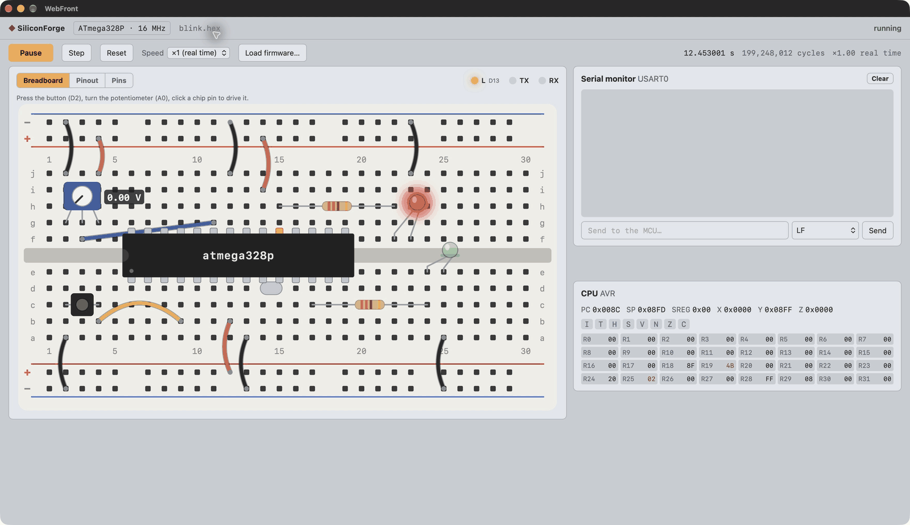
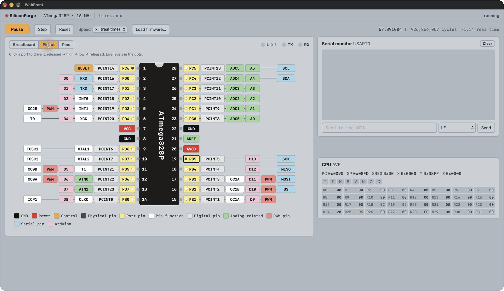

# SiliconForge

Français · [English (UK)](README.en.md)

**Testez immédiatement votre code embarqué, sans le transférer sur une carte.**

Chargez le binaire `.hex` ou `.elf` produit par votre chaîne de compilation et lancez-le sur un microcontrôleur
simulé. Avec SiliconForge, vous pouvez vérifier un clignotement, échanger des messages série, essayer une entrée
analogique ou observer vos registres sans brancher de matériel. Mettez l’exécution en pause, avancez instruction
par instruction et recommencez autant de fois que nécessaire.

SiliconForge est une application native multiplateforme écrite en C++, pour **macOS, Linux et Windows**.
Le premier microcontrôleur pris en charge est l’**ATmega328P à 16 MHz**, utilisé dans l’Arduino Uno.

## Votre code, un circuit, un résultat visible

La plaque d’essai réunit un microcontrôleur et des composants simulés. Dans cet exemple, le même firmware
`blink.hex` que vous chargeriez sur une carte fait clignoter la LED sur D13. Le temps simulé, les cycles et les
registres évoluent pendant l’exécution.



Le circuit de démonstration comprend déjà deux LED, des résistances, un bouton et un potentiomètre :

- **Observez vos sorties** : la LED sur D13 suit le programme et celle sur D6 reflète le rapport cyclique PWM.
- **Essayez vos entrées** : appuyez sur le bouton relié à D2 ou tournez le potentiomètre sur A0.
- **Dialoguez avec votre code** : envoyez du texte au microcontrôleur et lisez ses réponses dans le moniteur série.
- **Comprenez une anomalie** : suspendez l’exécution et inspectez les registres, puis avancez d’une instruction.

L’objectif est de vous permettre de **connecter vos propres composants et construire votre circuit autour du
microcontrôleur**. Aujourd’hui, les composants du circuit de démonstration sont précâblés ; l’ajout et le câblage
libres de composants font partie des prochaines étapes. Des afficheurs et des écrans simulés sont également prévus.

## Vérifier les broches

La vue **Pinout** montre les broches physiques, leurs fonctions et leurs noms Arduino. Les indicateurs suivent
les niveaux pendant l’exécution. Cliquez sur une entrée pour la forcer à l’état haut ou bas, puis la libérer,
et observez la réaction de votre code.



Le brochage indique aussi les fonctions du composant réel qui ne sont pas encore simulées.

## Ce que vous pouvez tester aujourd’hui

| Fonction | Disponible |
| --- | --- |
| Firmwares | Chargement Intel HEX et ELF, exécution, pause, pas à pas, réinitialisation et vitesse réglable |
| ATmega328P | Instructions et temporisations en cycles, interruptions internes, sommeil et auto-programmation |
| Mémoires | Flash de 32 Kio, SRAM de 2 Kio et EEPROM de 1 Kio |
| Entrées-sorties | Ports B, C et D, résistances de rappel, niveaux logiques et tensions analogiques |
| PWM et temporisation | Timer0 : normal, CTC, Fast PWM et Phase Correct PWM |
| Liaison série | USART0 asynchrone, envoi et réception dans le moniteur série |
| Conversion analogique | Conversions simples sur A0–A5 et référence interne |
| Tests automatisés | Pilotage du temps simulé, des broches et de la liaison série depuis un banc de test C++ |

**Limites actuelles :** Timer1/2, SPI, I²C/TWI, watchdog, comparateur analogique et interruptions externes ne sont
pas encore émulés. Leurs noms sur le brochage ne signifient pas qu’ils sont utilisables. D’autres microcontrôleurs,
dont l’ATmega2560, ainsi que des cibles ARM et RISC-V sont prévus.

## Essayer SiliconForge

Le projet se compile actuellement depuis les sources. Il faut **CMake 3.31+** et un compilateur avec bibliothèque
standard compatible **C++26** (GCC 16 sur la CI Linux, Apple Clang 21 pour les captures macOS). Les dépendances
sont téléchargées automatiquement lors de la configuration.

Sous Linux, installez aussi WebKitGTK 6.0 pour la fenêtre native : `sudo apt install libwebkitgtk-6.0-dev` sur
Debian/Ubuntu, ou `webkitgtk6.0-devel` sur Fedora. Sans moteur natif disponible, l’application ouvre le navigateur
système.

Depuis la racine du dépôt :

```bash
cmake -S . -B build
cmake --build build -j
./build/apps/siliconforge/siliconforge firmware/prebuilt/blink.hex
```

Les [exemples précompilés](firmware/README.md) permettent d’essayer immédiatement le clignotement, l’écho série,
les interruptions Timer0 et la PWM, sans installer de compilateur AVR.

Pour essayer votre propre code, remplacez le chemin de `blink.hex` par celui de votre binaire ATmega328P, ou
utilisez **Load firmware…** dans l’application. Aucune opération de programmation sur une carte n’est nécessaire.

## Automatiser vos vérifications

Vous pouvez exécuter un firmware sans affichage, accélérer le temps simulé et récupérer sa sortie série :

```bash
./build/apps/siliconforge/siliconforge --headless --speed max --duration 5 firmware/prebuilt/uart_echo.hex
```

Le [banc de test C++](include/siliconforge/testing/Bench.hpp) permet d’envoyer des données, de modifier des entrées
et de vérifier les réponses ou la période d’un signal de façon reproductible. Les [tests de firmwares](tests/integration/FirmwareTests.cpp)
fournissent des exemples. Pour exécuter les tests du projet :

```bash
ctest --test-dir build --output-on-failure
```

## Pour aller plus loin

- [Firmwares de démonstration](firmware/README.md)
- [Descriptions des microcontrôleurs et limites du modèle](docs/MCU-DESCRIPTIONS.md)
- [Architecture et contribution](docs/ARCHITECTURE.md)
- [Orientations du projet](docs/adr)

## Licence

SiliconForge est proposé sous double licence **Apache-2.0 OR CECILL-B**, au choix. Le fichier [LICENSE](LICENSE)
contient les textes complets, dont les versions française et anglaise de CeCILL-B. Les composants tiers conservent
leurs propres licences.
