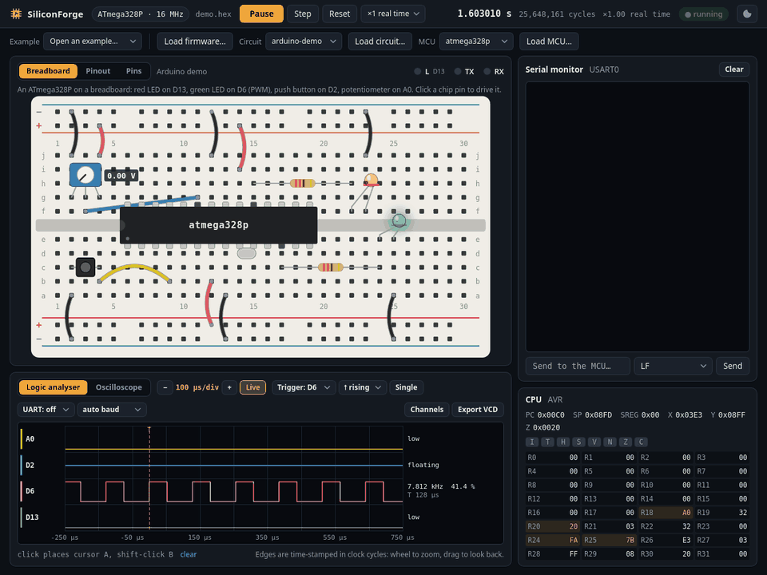
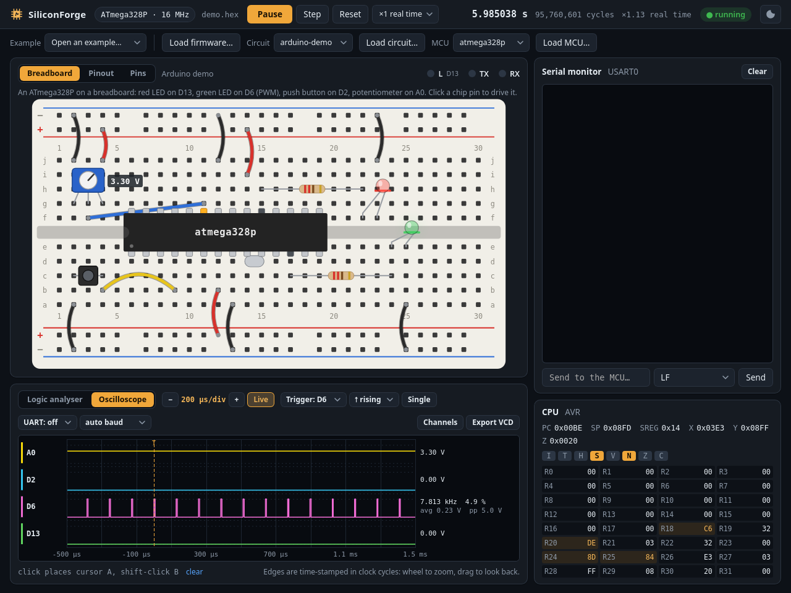
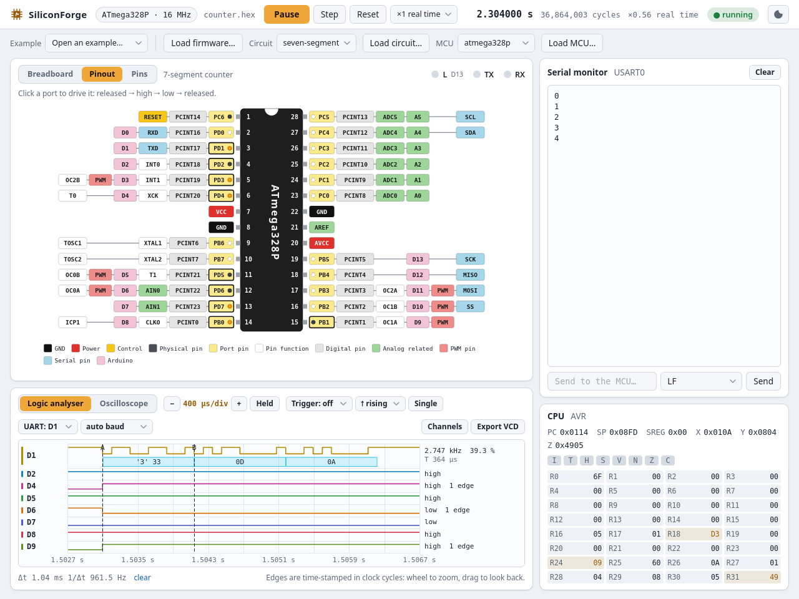

# SiliconForge

Français · [English (UK)](README.en.md)

**Testez immédiatement votre code embarqué, sans le transférer sur une carte.**

Chargez le binaire `.hex` ou `.elf` produit par votre chaîne de compilation et lancez-le sur un microcontrôleur
simulé. Avec SiliconForge, vous pouvez vérifier un clignotement, échanger des messages série, essayer une entrée
analogique ou observer vos registres sans brancher de matériel. Mettez l’exécution en pause, avancez instruction
par instruction et recommencez autant de fois que nécessaire.

SiliconForge est une application native multiplateforme écrite en C++, pour **macOS, Linux et Windows**.
Le premier microcontrôleur pris en charge est l’**ATmega328P à 16 MHz**, utilisé dans l’Arduino Uno.

## Votre code, un circuit, un résultat visible

La plaque d’essai réunit un microcontrôleur et des composants simulés. Lancez l’application, choisissez
**Open an example…** : le firmware `demo.hex`, le même que vous chargeriez sur une carte, fait clignoter la LED
rouge sur D13 et « respirer » la LED verte sur D6 par PWM, pendant que l’analyseur logique affiche le signal.



- **Observez vos sorties** : le courant de chaque LED est calculé à partir du circuit (tension de seuil, résistance),
  et une LED en PWM s’éclaire comme l’œil la voit.
- **Essayez vos entrées** : appuyez sur un bouton, tournez le potentiomètre, ou cliquez sur une broche pour la forcer.
- **Dialoguez avec votre code** : envoyez du texte au microcontrôleur et lisez ses réponses dans le moniteur série.
- **Comprenez une anomalie** : suspendez l’exécution et inspectez les registres, puis avancez d’une instruction.
- **Repérez une erreur de câblage** : une sortie reliée à un rail, ou deux sorties opposées, sont signalées comme
  un court-circuit.

## Mesurer, comme sur l’établi

Chaque changement d’une broche est enregistré avec le cycle d’horloge où il se produit : 62,5 ns de résolution à
16 MHz, sans échantillonnage, quelle que soit la vitesse de l’émulation. Le panneau **Instruments** en fait un
analyseur logique et un oscilloscope : fréquence et rapport cyclique, curseurs, déclenchement sur front, décodage des
trames UART, export VCD pour GTKWave ou PulseView. Voir le [guide des instruments](docs/INSTRUMENTS.md).




## Changer de circuit

Un circuit est un fichier JSON : la puce, les composants posés sur les trous de la plaque et les fils. Trois sont
fournis (LED et potentiomètre, afficheur 7 segments, LED et deux boutons) ; chargez le vôtre par
`--circuit montage.json`, **Load circuit…** ou glisser-déposer. Les composants disponibles sont la LED, la résistance,
le bouton-poussoir, le potentiomètre, l’afficheur 7 segments et le quartz ; le [guide des circuits](docs/CIRCUITS.md)
explique comment en ajouter. L’édition graphique du circuit et les écrans simulés font partie des prochaines étapes.

## Vérifier les broches

La vue **Pinout** montre les broches physiques, leurs fonctions et leurs noms Arduino. Les indicateurs suivent
les niveaux pendant l’exécution. Cliquez sur une entrée pour la forcer à l’état haut ou bas, puis la libérer,
et observez la réaction de votre code.



Le brochage indique aussi les fonctions du composant réel qui ne sont pas encore simulées.

## Ce que vous pouvez tester aujourd’hui

| Fonction | Disponible |
| --- | --- |
| Firmwares | Chargement Intel HEX et ELF, exécution, pause, pas à pas, réinitialisation et vitesse réglable |
| ATmega328P | Instructions et temporisations en cycles, interruptions internes, sommeil et auto-programmation |
| Mémoires | Flash de 32 Kio, SRAM de 2 Kio et EEPROM de 1 Kio |
| Entrées-sorties | Ports B, C et D, résistances de rappel, niveaux logiques et tensions analogiques |
| PWM et temporisation | Timer0 : normal, CTC, Fast PWM et Phase Correct PWM |
| Liaison série | USART0 asynchrone, envoi et réception dans le moniteur série, trames visibles bit par bit sur TXD |
| Circuits | Modèle électrique résistif : LED, résistances, boutons, potentiomètres, afficheur 7 segments, détection des courts-circuits |
| Instruments | Analyseur logique et oscilloscope au cycle près, mesures, curseurs, déclenchement, décodeur UART, export VCD |
| Conversion analogique | Conversions simples sur A0–A5 et référence interne |
| Tests automatisés | Pilotage du temps simulé, des broches, de la liaison série et des composants du circuit depuis un banc de test C++ |
| Scénarios de banc | Essais versionnés exécutés sans fenêtre : stimuli planifiés en cycles, attentes bornées, mesures de PWM avec verdict, rapport et trace VCD |

**Qualification du cœur :** l’ATmega328P est **qualifié, avec exceptions documentées** : ses 85 instructions sont
vérifiées contre le manuel AVR (cycles de chaque cas), contre le simulateur simavr (instruction par instruction sur des
programmes aléatoires : 150 000 instructions à chaque build, 74 millions en campagne longue) et par des programmes C
compilés en `-O0`, `-O2` et `-Os`. Voir la
[matrice de qualification](docs/qualification/README.md).

**Limites actuelles :** Timer1/2, SPI, I²C/TWI, watchdog, comparateur analogique et interruptions externes ne sont
pas encore émulés. Leurs noms sur le brochage ne signifient pas qu’ils sont utilisables. D’autres microcontrôleurs,
dont l’ATmega2560, ainsi que des cibles ARM et RISC-V sont prévus.

## Essayer SiliconForge

Le projet se compile actuellement depuis les sources. Il faut **CMake 3.31+** et un compilateur avec bibliothèque
standard compatible **C++26** (GCC 16 sur la CI Linux). Les dépendances
sont téléchargées automatiquement lors de la configuration. Ni Python ni Node.js ne sont
nécessaires : les outils du dépôt sont en C++ et compilés avec le reste dans `build/tools/` ([bilan](docs/PYTHON-STUDY.md)).

Sous Linux, installez aussi WebKitGTK 6.0 pour la fenêtre native : `sudo apt install libwebkitgtk-6.0-dev` sur
Debian/Ubuntu, ou `webkitgtk6.0-devel` sur Fedora. Sans moteur natif disponible, l’application ouvre le navigateur
système.

Depuis la racine du dépôt :

```bash
cmake -S . -B build
cmake --build build -j
./build/apps/siliconforge/siliconforge
```

Le menu **Open an example…** charge un [firmware précompilé](firmware/README.md) avec son circuit : LED et PWM,
compteur 7 segments, boutons, écho série, interruptions Timer0. Aucun compilateur AVR n’est nécessaire.

Pour essayer votre propre code, donnez le chemin de votre binaire ATmega328P sur la ligne de commande, ou
utilisez **Load firmware…** dans l’application. Aucune opération de programmation sur une carte n’est nécessaire.

## Automatiser vos vérifications

Vous pouvez exécuter un firmware sans affichage, accélérer le temps simulé et récupérer sa sortie série :

```bash
./build/apps/siliconforge/siliconforge --headless --speed max --duration 5 firmware/prebuilt/uart_echo.hex
```

Un [scénario de banc](docs/BANC.md) décrit un essai dans un fichier JSON versionné avec le projet : circuit,
firmware, stimuli, attentes bornées et mesures attendues. `siliconforge-bench` l’exécute, conserve le rapport et la
trace, et distingue par son code de sortie la réussite (0), l’échec d’une assertion (1) et un banc incompatible (2) :

```bash
./build/apps/siliconforge-bench/siliconforge-bench run scenarios/pwm-setpoint.json
```

Le [banc de test C++](include/siliconforge/testing/Bench.hpp) permet d’envoyer des données, de modifier des entrées
et de vérifier les réponses ou la période d’un signal de façon reproductible. Branché sur un circuit, il voit ce
que voit l’utilisateur : `bench.press("button-d2")`, `bench.component("led-d13").brightness()`. Les [tests de firmwares](tests/integration/FirmwareTests.cpp)
fournissent des exemples. Pour exécuter les tests du projet :

```bash
ctest --test-dir build --output-on-failure
```

## Décrire un microcontrôleur

Les paramètres de la puce, les temps d’instruction, les périphériques et les brochages viennent de fichiers JSON
versionnés. `--mcu-file puce.json` charge une description sans recompiler, et `--mcu-path répertoire` en découvre
tout un répertoire. L’interface accepte aussi ces fichiers via **Load MCU…** ou par glisser-déposer. Le
[guide du format et de l’import ATDF](docs/MCU-DESCRIPTIONS.md) détaille la procédure.

## Pour aller plus loin

- [Firmwares de démonstration](firmware/README.md)
- [Descriptions des microcontrôleurs et limites du modèle](docs/MCU-DESCRIPTIONS.md)
- [Format des composants et des circuits](docs/CIRCUITS.md)
- [Instruments : analyseur logique et oscilloscope](docs/INSTRUMENTS.md)
- [Banc programmable : scénarios et `siliconforge-bench`](docs/BANC.md)
- [Terminal agentique : Claude Code, Codex, OpenCode ou Mistral Vibe dans la fenêtre](docs/TERMINAL.md)
- [Éditeur des sources : relire et modifier ce que l’agent a changé, avec les différences Git](docs/EDITOR.md)
- [Qualification du cœur : méthode](docs/QUALIFICATION.md) et [matrice par puce](docs/qualification/README.md)
- [Architecture et contribution](docs/ARCHITECTURE.md)
- [WebFront 1.0 : passage, adoption et décisions](docs/WEBFRONT-1.0.md) (bilans précédents : [0.9](docs/WEBFRONT-0.9.md), [0.8](docs/WEBFRONT-0.8.md), [0.7](docs/WEBFRONT-0.7.md))
- [Orientations du projet](docs/adr)

## Licence

SiliconForge est proposé sous double licence **Apache-2.0 OR CECILL-B**, au choix. Le fichier [LICENSE](LICENSE)
contient les textes complets, dont les versions française et anglaise de CeCILL-B. Les composants tiers conservent
leurs propres licences.

WebFront 1.0 : [passage et adoption](docs/WEBFRONT-1.0.md).
