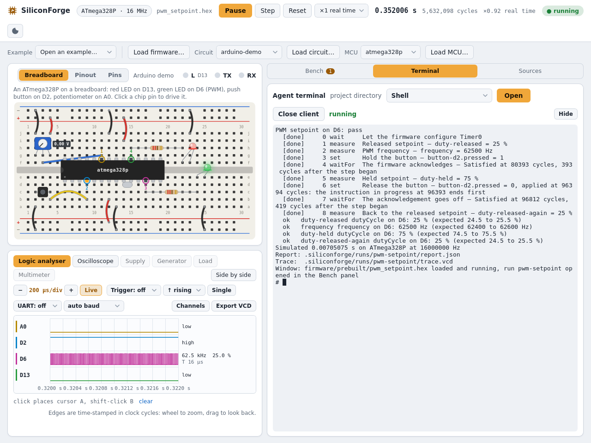
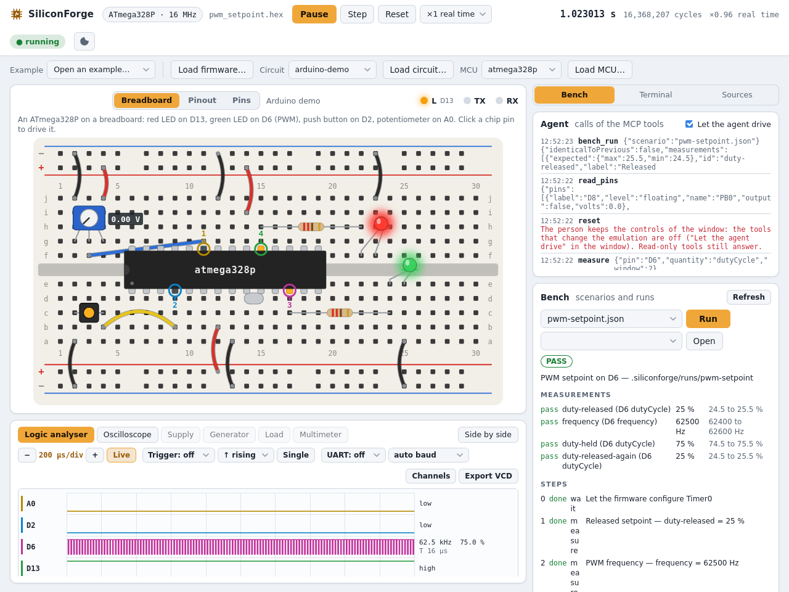
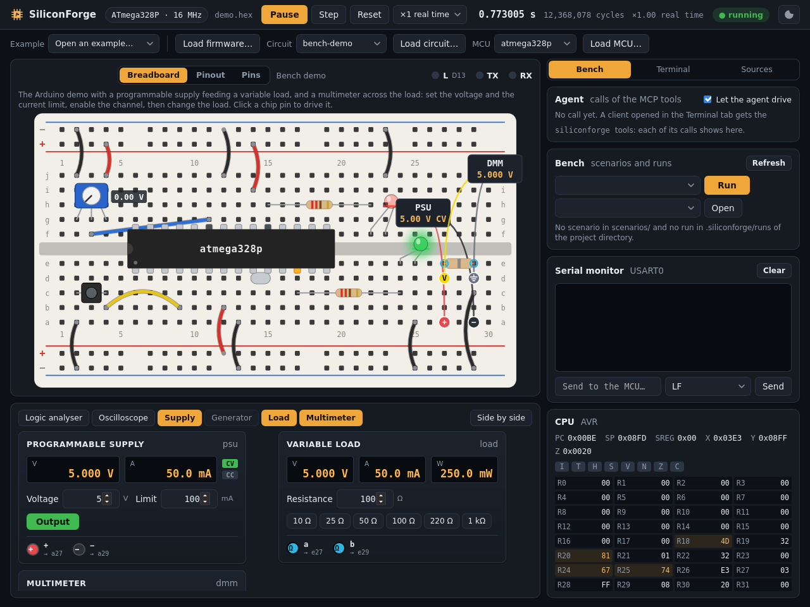
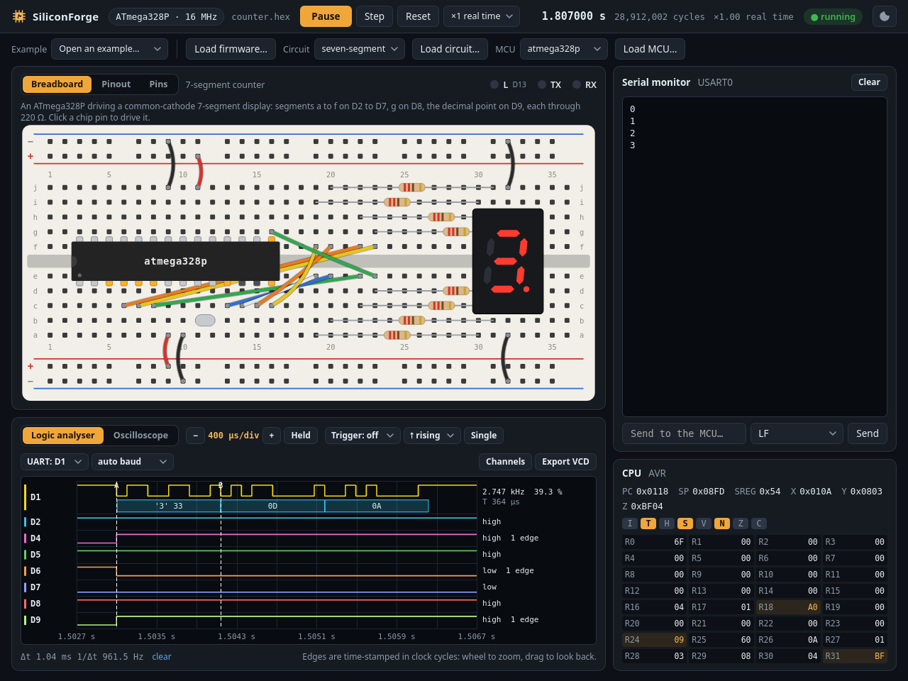
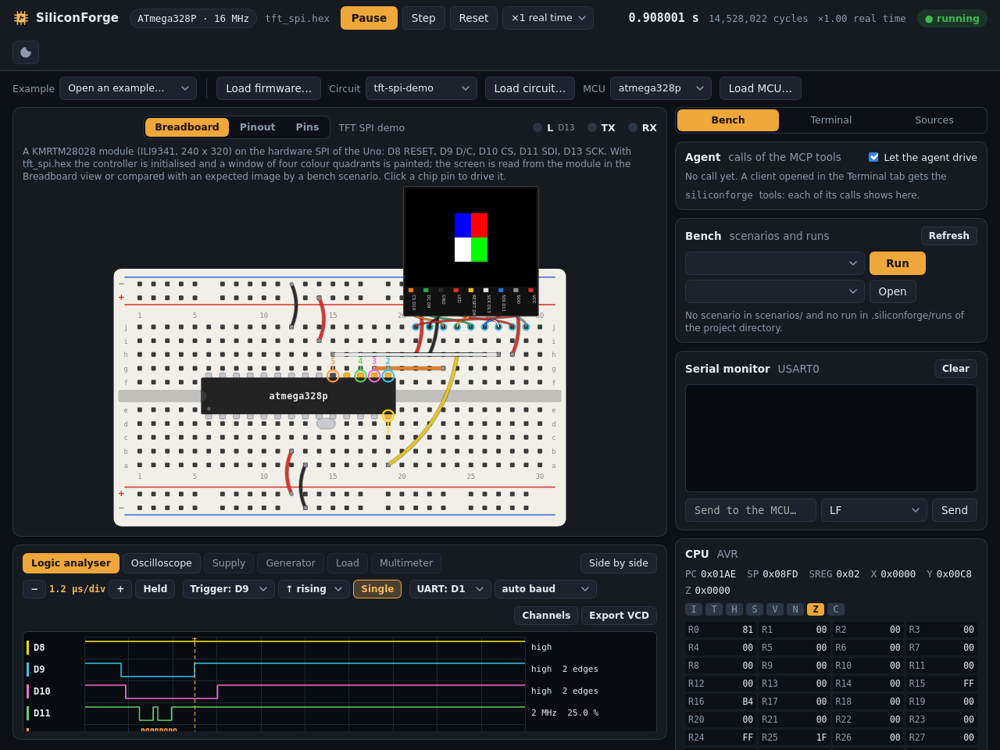

# SiliconForge

Français · [English (UK)](README.en.md)

Banc d’essai simulé pour microcontrôleurs, sur lequel un agent de programmation peut compiler, essayer et corriger
un firmware.

SiliconForge simule au cycle près un microcontrôleur, le circuit qui lui est raccordé et les instruments de mesure
d’un établi d’électronique. On peut s’en servir comme d’un simulateur ordinaire, mais il a d’abord été conçu pour le
développement assisté par agent. Un agent tel que Claude Code ou OpenCode sait écrire et compiler un pilote. Il ne
sait pas, en revanche, programmer la carte, appuyer sur un bouton ou lire un oscilloscope : jusqu’ici, quelqu’un
devait le faire à sa place. SiliconForge lui en donne les moyens. L’agent charge le binaire qu’il vient de produire,
agit sur le circuit, mesure la réponse et reçoit un verdict, puis il corrige son code et recommence. Le projet parle
de **fonderie agentique** pour désigner cet atelier où l’agent façonne le firmware et le confronte au matériel.

SiliconForge ne remplace pas l’agent. Le raisonnement, la modification des fichiers et l’appel des outils restent
l’affaire de votre client (Claude Code, OpenCode, Codex ou Mistral Vibe), avec votre abonnement et vos réglages.
SiliconForge fournit ce qui lui manque pour travailler sur de l’embarqué : une carte, un circuit, des instruments et
des résultats reproductibles.

SiliconForge est une application native écrite en C++, pour macOS, Linux et Windows. Le premier microcontrôleur pris
en charge est l’ATmega328P à 16 MHz, celui de l’Arduino Uno.

> SiliconForge est pour l’instant un démonstrateur : il sert à comprendre comment un tel outil s’utilise et quelles
> fonctions il doit offrir. Voir les [prochaines étapes](#prochaines-étapes).

## Répartition des rôles

| | Rôle |
| --- | --- |
| L’agent | Lit la consigne, modifie le firmware, le compile avec la chaîne du projet, interprète le verdict et choisit la correction |
| SiliconForge | Exécute le binaire sur le microcontrôleur simulé, dans son circuit ; applique les stimuli, mesure au cycle près et rend un verdict accompagné de preuves reproductibles (rapport, trace VCD, empreintes des fichiers d’entrée) |
| La personne | Suit les actions de l’agent sur la carte et les instruments, relit les modifications dans l’éditeur et peut reprendre la main à tout moment |

L’agent accède au banc de trois façons :

- **En ligne de commande.** `siliconforge bench run scénario.json` exécute un essai décrit dans un fichier versionné,
  sans ouvrir de fenêtre. Le code de retour distingue la réussite (0), l’échec d’une vérification (1) et un banc
  incompatible avec l’essai (2). Deux essais menés sur les mêmes fichiers produisent un rapport et une trace
  identiques à l’octet près.
- **Par MCP, sur la fenêtre ouverte.** Le client lancé dans le terminal de la fenêtre dispose des outils
  `siliconforge` : `load_firmware`, `set_component`, `set_waveform`, `serial_send`, `read_pins`, `measure`,
  `bench_run`, etc. Ils agissent sur l’émulation affichée. Chaque appel est consigné dans le journal **Agent**, et la
  case **Let the agent drive** permet de retirer à l’agent tout ce qui modifierait l’émulation
  ([guide](docs/AGENT-MCP.md)).
- **Dans la fenêtre elle-même.** La colonne de droite regroupe le **Terminal**, où tourne le client, et les
  **Sources**, un éditeur qui affiche les différences Git introduites par l’agent. Le panneau **Bench** présente les
  essais, qu’ils aient été lancés par l’agent ou à la main.

### Exemple : une impulsion que seule la mesure révèle

La consigne demande que la PWM de D6 soit nulle lorsque le bouton est relâché. La correction qui vient à l’esprit,
`OCR0A = 0`, ne suffit pas : en Fast PWM, le timer laisse passer une impulsion de 62,5 ns à chaque période, comme il
le ferait sur une vraie carte. Le banc la mesure, l’agent la lit dans le verdict et déconnecte OC0A au second essai :

```console
$ siliconforge bench run scenarios/pwm-setpoint.json; echo $?
PWM setpoint on D6: fail
  FAIL duty-released dutyCycle on D6: 0.390625 % (expected 0 to 0.1 %)
  ok   duty-held dutyCycle on D6: 75 % (expected 74.5 to 75.5 %)
  ok   frequency frequency on D6: 62500 Hz (expected 62400 to 62600 Hz)
1
```

L’exercice complet, mené avec et sans la fonderie, et la manière de le rejouer sont décrits dans
[FOUNDRY.md](docs/FOUNDRY.md).





## La plaque d’essai

La plaque d’essai réunit un microcontrôleur et des composants simulés. On y charge le binaire `.hex` ou `.elf` produit
par la chaîne de compilation, ou l’un des exemples du menu **Open an example…**. Le firmware `demo.hex`, le même que
celui que l’on programmerait sur une carte, fait clignoter la LED rouge de D13 et « respirer » la LED verte de D6 par
PWM, tandis que l’analyseur logique affiche le signal.


- **Sorties.** Le courant de chaque LED est calculé à partir du circuit (tension de seuil, résistance) ; une LED
  commandée en PWM s’éclaire comme l’œil la perçoit. Un écran TFT affiche les pixels écrits par le firmware.
- **Entrées.** On peut appuyer sur un bouton, tourner le potentiomètre, forcer une broche d’un clic ou injecter un
  signal avec le générateur.
- **Liaison série.** Le moniteur série envoie du texte au microcontrôleur et affiche ses réponses.
- **Mise au point.** L’exécution peut être suspendue, les registres examinés et le programme avancé instruction par
  instruction.
- **Câblage.** Une sortie reliée à un rail, deux sorties qui s’opposent ou une alimentation en surcharge sont
  signalées.

## Les instruments

Chaque changement d’état d’une broche est enregistré avec le cycle d’horloge où il a lieu, soit une résolution de
62,5 ns à 16 MHz, sans échantillonnage et quelle que soit la vitesse de l’émulation. Le panneau du bas regroupe les
appareils, que l’on peut afficher un par un ou côte à côte :

- **Analyseur logique et oscilloscope** : fréquence et rapport cyclique, curseurs, déclenchement sur front, décodage
  des trames UART, export VCD pour GTKWave, PulseView ou Surfer.
- **Alimentation de laboratoire** : consigne de tension, limitation de courant, voyants CV/CC.
- **Charge variable** et **multimètre**.
- **Générateur de signaux** : sinus, carré, triangle ou onde arbitraire, avec des pas planifiés sur l’horloge du MCU.

Voir le [guide des instruments](docs/INSTRUMENTS.md).






## Écrans TFT

Deux modules courants sont simulés : le KMRTM28028 (ILI9341, 240 × 320, SPI) et le shield MCUFRIEND 3,5"
(ILI9481, 320 × 480, bus parallèle 8 bits). Le décodeur lit les niveaux des broches au cycle près : un firmware qui
utilise le SPI matériel et un firmware qui commande les broches une à une sont décodés de la même manière. La dalle
peut être déplacée au-dessus de la plaque, et chaque connecteur porte le nom de la broche de l’ATmega à laquelle il
est relié.

Dans un scénario de banc, une étape `screen` compare l’écran à une image de référence, ce qui permet à un agent de
vérifier qu’un pilote d’affichage dessine ce qu’on attend de lui. Un écran éteint, en veille ou sans rétroéclairage
reste noir et échoue à la comparaison ([format](docs/CIRCUITS.md#écrans-tft), [banc](docs/BANC.md#écran)).



## Changer de circuit

Un circuit est un fichier JSON qui décrit la puce, les composants posés sur les trous de la plaque et les fils.
Plusieurs circuits sont fournis : LED et potentiomètre, afficheur 7 segments, LED et deux boutons, établi
d’alimentation, générateur de signaux, écrans SPI et parallèle, afficheur LCD 1602 en parallèle et en I2C. Un autre
circuit se charge avec `--circuit montage.json`, le bouton **Load circuit…** ou par glisser-déposer.

Les composants disponibles sont la LED, la résistance, le bouton-poussoir, le potentiomètre, l’afficheur 7 segments,
le quartz, l’alimentation pilotable, la charge variable, le multimètre, le générateur de signaux, les deux écrans
TFT et l’afficheur LCD 1602 (HD44780), en parallèle ou derrière un module I2C (PCF8574). Le
[guide des circuits](docs/CIRCUITS.md) explique comment en ajouter. L’édition graphique du circuit fait partie des
prochaines étapes.

## Vérifier les broches

La vue **Pinout** montre les broches physiques, leurs fonctions et leurs noms Arduino. Les indicateurs suivent
les niveaux pendant l’exécution. Un clic sur une entrée la force à l’état haut ou bas ; on la libère ensuite pour
observer la réaction du firmware.


Le brochage indique aussi les fonctions du composant réel qui ne sont pas encore simulées.

## Fonctions disponibles

| Fonction | Disponible |
| --- | --- |
| Firmwares | Chargement Intel HEX et ELF, exécution, pause, pas à pas, réinitialisation et vitesse réglable |
| ATmega328P | Instructions et temporisations en cycles, interruptions internes, sommeil et auto-programmation |
| Mémoires | Flash de 32 Kio, SRAM de 2 Kio et EEPROM de 1 Kio |
| Entrées-sorties | Ports B, C et D, résistances de rappel, niveaux logiques et tensions analogiques |
| PWM et temporisation | Timer0 : normal, CTC, Fast PWM et Phase Correct PWM |
| Liaison série | USART0 asynchrone, envoi et réception dans le moniteur série, trames visibles bit par bit sur TXD |
| SPI | Mode maître, fronts d’horloge et données datés au cycle, perte du mode maître par SS |
| TWI (I²C) | Mode maître, lignes à drain ouvert, fronts datés au cycle, START répété, codes d’état, perte d’arbitrage |
| Circuits | Modèle électrique résistif : LED, résistances, boutons, potentiomètres, afficheur 7 segments, détection des courts-circuits |
| Appareils du banc | Alimentation à limitation de courant, charge variable, multimètre, générateur de signaux (périodique ou arbitraire) |
| Écrans | ILI9341 en SPI et ILI9481 en parallèle : fenêtres, orientation, RGB565 et 18 bits, veille, rétroéclairage ; afficheur à caractères LCD 1602 (HD44780) en 4 ou 8 bits ou par un module I2C PCF8574, drapeau *busy*, CGRAM, contraste |
| Instruments | Analyseur logique et oscilloscope au cycle près, mesures, curseurs, déclenchement, décodeur UART, export VCD |
| Conversion analogique | Conversions simples sur A0–A5 et référence interne |
| Scénarios de banc | Essais versionnés exécutés sans fenêtre ou dans le panneau Bench : stimuli planifiés en cycles, attentes bornées, mesures avec verdict, comparaison d’écran, rapport et trace reproductibles |
| Pilotage par un agent | Serveur MCP local authentifié par jeton, terminal intégré pour Claude Code, Codex, OpenCode et Mistral Vibe, éditeur avec différences Git |
| Tests automatisés | Pilotage du temps simulé, des broches, de la liaison série et des composants du circuit depuis un banc de test C++ |

**Qualification du cœur :** l’ATmega328P est **qualifié, avec exceptions documentées**. Ses 85 instructions sont
vérifiées de trois façons :

- contre le manuel AVR, avec les cycles de chaque cas ;
- contre le simulateur simavr, instruction par instruction sur des programmes aléatoires : 150 000 instructions à
  chaque build, 74 millions en campagne longue ;
- par des programmes C compilés en `-O0`, `-O2` et `-Os`.

Voir la [matrice de qualification](docs/qualification/README.md).

**Limites actuelles :** Timer1/2, les modes esclaves du SPI et du TWI, watchdog, comparateur analogique et
interruptions externes ne sont pas encore émulés. Leurs noms sur le brochage ne signifient pas qu’ils sont
utilisables. D’autres microcontrôleurs, dont l’ATmega2560, ainsi que des cibles ARM et RISC-V sont prévus.

## Essayer SiliconForge

Le projet se compile actuellement depuis les sources. Il faut **CMake 3.31+** et un compilateur avec bibliothèque
standard compatible **C++26** (GCC 16 sur la CI Linux). Les dépendances sont téléchargées automatiquement lors de la
configuration. Ni Python ni Node.js ne sont nécessaires : les outils du dépôt sont en C++ et compilés avec le reste
dans `build/tools/` ([bilan](docs/PYTHON-STUDY.md)).

Sous Linux, installez aussi WebKitGTK 6.0 pour la fenêtre native : `sudo apt install libwebkitgtk-6.0-dev` sur
Debian/Ubuntu, ou `webkitgtk6.0-devel` sur Fedora. Sans moteur natif disponible, l’application ouvre le navigateur
système.

Depuis la racine du dépôt :

```bash
cmake -S . -B build
cmake --build build -j
./build/apps/siliconforge/siliconforge
```

Le menu **Open an example…** charge un [firmware précompilé](firmware/README.md) avec son circuit : LED et PWM,
compteur 7 segments, boutons, écho série, consigne PWM, écran SPI, afficheur LCD 1602 (parallèle et I2C),
interruptions Timer0. Aucun compilateur AVR n’est nécessaire.

Pour essayer votre propre code, donnez le chemin de votre binaire ATmega328P sur la ligne de commande, ou
utilisez **Load firmware…** dans l’application. Aucune opération de programmation sur une carte n’est nécessaire.

### Avec un agent

Lancez `siliconforge` depuis le répertoire de votre projet de firmware. Ouvrez l’onglet **Terminal** et choisissez
votre client parmi ceux installés. Il démarre dans le projet, avec les outils MCP de la fenêtre déjà configurés pour
Claude Code, Codex et OpenCode. Mistral Vibe se configure une fois, comme l’indique le [guide](docs/AGENT-MCP.md).
Décrivez la consigne à l’agent, de préférence sous forme d’un scénario dans `scenarios/`, et suivez son travail sur la
carte, dans le journal **Agent** et dans l’onglet **Sources**.

## Automatiser les vérifications

Vous pouvez exécuter un firmware sans affichage, accélérer le temps simulé et récupérer sa sortie série :

```bash
./build/apps/siliconforge/siliconforge --headless --speed max --duration 5 firmware/prebuilt/uart_echo.hex
```

Un [scénario de banc](docs/BANC.md) décrit un essai dans un fichier JSON versionné avec le projet : circuit,
firmware, stimuli, attentes bornées, mesures et images attendues. `siliconforge bench` l’exécute et conserve le
rapport et la trace dans `.siliconforge/runs/` :

```bash
./build/apps/siliconforge/siliconforge bench run scenarios/pwm-setpoint.json
```

Le [banc de test C++](include/siliconforge/testing/Bench.hpp) permet d’envoyer des données, de modifier des entrées
et de vérifier les réponses ou la période d’un signal de façon reproductible. Branché sur un circuit, il voit ce
que voit l’utilisateur : `bench.press("button-d2")`, `bench.component("led-d13").brightness()`. Les
[tests de firmwares](tests/integration/FirmwareTests.cpp) fournissent des exemples. Pour exécuter les tests du
projet :

```bash
ctest --test-dir build --output-on-failure
```

## Décrire un microcontrôleur

Les paramètres de la puce, les temps d’instruction, les périphériques et les brochages viennent de fichiers JSON
versionnés. `--mcu-file puce.json` charge une description sans recompiler, et `--mcu-path répertoire` en découvre
tout un répertoire. L’interface accepte aussi ces fichiers via **Load MCU…** ou par glisser-déposer. Le
[guide du format et de l’import ATDF](docs/MCU-DESCRIPTIONS.md) détaille la procédure.

## Prochaines étapes

Les prochains développements porteront sur les points suivants.

- **Inférence locale.** Des modèles exécutés sur la machine interpréteront ce que le banc capte, notamment le son et
  l’image. L’agent pourra ainsi raisonner sur ce qu’un circuit émet ou affiche, et pas seulement sur des niveaux
  logiques et des tensions.
- **Version en ligne** ([épique #90](https://github.com/ambroise-leclerc/SiliconForge/issues/90)). SiliconForge utilisable
  depuis un navigateur, sans installation ; chaque session a sa propre adresse, que l’on peut conserver et partager.
- **Une première cible physique** ([#65](https://github.com/ambroise-leclerc/SiliconForge/issues/65)) : étendre le
  banc à une vraie carte.

## Pour aller plus loin

- [L’agent dans la fenêtre : les outils MCP qui chargent, actionnent et mesurent dans la fenêtre affichée](docs/AGENT-MCP.md)
- [Terminal agentique : Claude Code, Codex, OpenCode ou Mistral Vibe dans la fenêtre](docs/TERMINAL.md)
- [Éditeur des sources : relire et modifier ce que l’agent a changé, avec les différences Git](docs/EDITOR.md)
- [Banc programmable : scénarios et `siliconforge bench`](docs/BANC.md)
- [La boucle de correction PWM : de la consigne à la mesure reproductible, avec et sans la fonderie](docs/FOUNDRY.md)
- [Instruments et appareils du banc](docs/INSTRUMENTS.md)
- [Format des composants et des circuits, écrans TFT compris](docs/CIRCUITS.md)
- [Firmwares de démonstration](firmware/README.md)
- [Descriptions des microcontrôleurs et limites du modèle](docs/MCU-DESCRIPTIONS.md)
- [Qualification du cœur : méthode](docs/QUALIFICATION.md) et [matrice par puce](docs/qualification/README.md)
- [Architecture et contribution](docs/ARCHITECTURE.md)
- [WebFront 1.2 : passage, adoption et décisions](docs/WEBFRONT-1.2.md) (bilans précédents : [1.0](docs/WEBFRONT-1.0.md), [0.9](docs/WEBFRONT-0.9.md), [0.8](docs/WEBFRONT-0.8.md), [0.7](docs/WEBFRONT-0.7.md))
- [Orientations du projet](docs/adr)

## Droits d’auteur

© 2026 Ambroise Leclerc. Tous droits réservés.

Le code source de SiliconForge est public pour être consulté, mais il n’est pas distribué sous licence libre : aucun
droit d’utilisation, de modification ou de redistribution n’est accordé au-delà de la consultation et de la copie
par « fork » que permettent les conditions d’utilisation de GitHub. Les composants tiers conservent leurs
propres licences.
