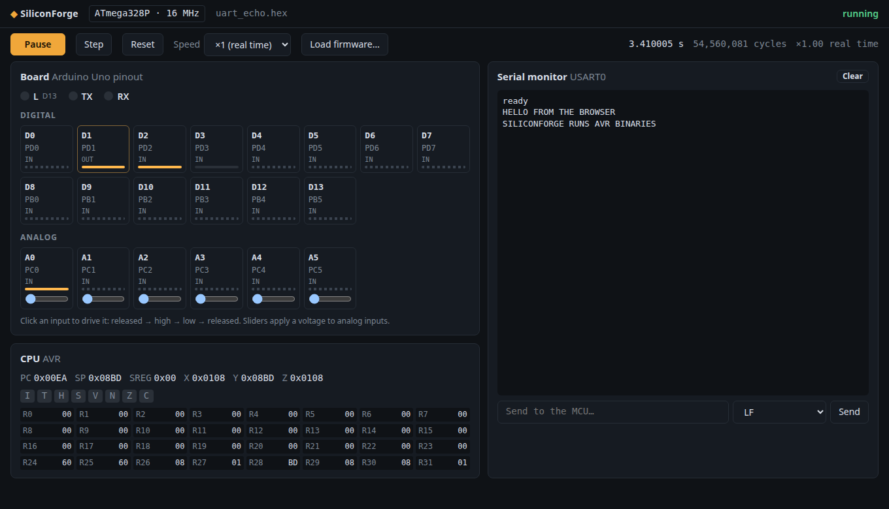
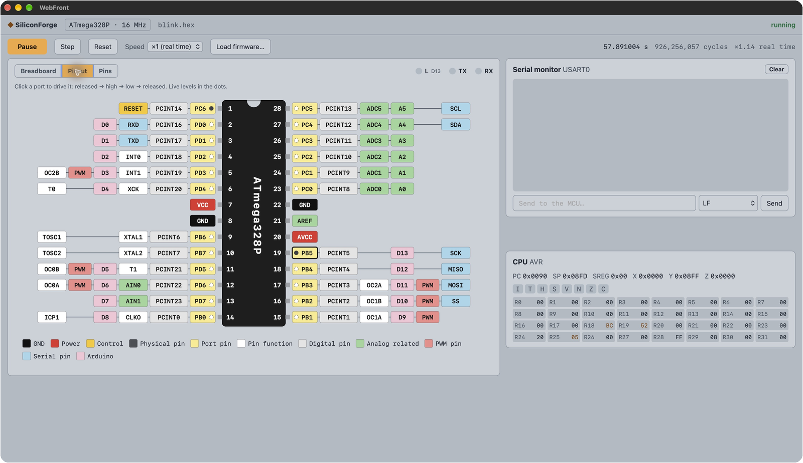

# SiliconForge

**A microcontroller emulator for fast firmware iteration, with a web interface and automated tests built in.**

SiliconForge runs the very binaries your toolchain produces (`.hex` or `.elf`) on an emulated MCU, precise to the
clock cycle, with simulated peripherals and I/O. Its interface is served by [WebFront](https://github.com/ambroise-leclerc/WebFront):
the chip on a breadboard with a few components, its pinout, the serial monitor and the CPU state live in a native
window, or in a browser page, locally or over the network.

Because the emulated MCU is deterministic and scriptable, firmware becomes testable like any other software:
C++ tests drive it through a test bench, and UI tests drive it through the same page a developer uses.



The **breadboard** view wires LEDs, a push button and a potentiometer to the chip: the LED on D13 blinks with the
firmware, the one on D6 shows its PWM duty cycle, the button and the potentiometer drive D2 and A0. The **pinout**
view shows every pin with its port, functions and Arduino name, and its live level:



## Status

First target: **ATmega328P** (Arduino Uno).

| Part | State |
| --- | --- |
| AVRe+ core | Complete instruction set of the ATmega328P with documented cycle counts, interrupts (priorities, 4-cycle response, SEI/RETI delay), sleep, BREAK, self-programming (SPM) |
| Memories | 32 KiB flash, 2 KiB SRAM, 1 KiB EEPROM (with write timing) |
| GPIO | Ports B, C, D: DDR/PORT/PIN, PIN toggle, pull-ups, `MCUCR.PUD` |
| Timer/Counter0 | Normal, CTC, Fast PWM, Phase Correct PWM, OC0A/OC0B outputs, interrupts |
| USART0 | Asynchronous mode timed at the baud rate, 2-level receive FIFO with overrun, interrupts |
| ADC | Single conversions on A0-A5 and the bandgap, with conversion time |
| Not yet | Timer1/2, SPI, TWI, watchdog, analog comparator, external interrupts (their registers act as plain storage) |

Emulation speed: about 170 MHz of simulated clock on a desktop CPU in Release builds, i.e. ten times real time for a
16 MHz ATmega328P.

## Quick start

Requirements: a C++26 compiler (GCC 16) and CMake 3.31+. Dependencies (WebFront, Catch2) are fetched by CPM. For a
native window on Linux, install WebKitGTK 6.0 (`sudo apt install libwebkitgtk-6.0-dev` on Ubuntu/Debian,
`webkitgtk6.0-devel` on Fedora); without it, the interface opens in the system browser.

```bash
mkdir build && cd build
cmake ..            # Release by default
cmake --build . -j
apps/siliconforge/siliconforge ../firmware/prebuilt/blink.hex
```

Other uses:

```bash
# The system browser instead of a window
siliconforge --browser firmware.hex

# Serve the interface to other machines (http://<host>:9002/) without opening anything
siliconforge --address 0.0.0.0 --no-browser firmware.elf

# Headless: run 5 simulated seconds as fast as possible, serial output on stdout
siliconforge --headless --speed max --duration 5 firmware.hex
```

Run the tests from the build directory:

```bash
ctest --output-on-failure
```

## Testing firmware

The test bench (`include/siliconforge/testing/Bench.hpp`) loads a firmware, advances simulated time and observes it.
Everything is deterministic and runs faster than real time:

```cpp
#include <siliconforge/mcu/Registry.hpp>
#include <siliconforge/testing/Bench.hpp>

using namespace std::chrono_literals;

TEST_CASE("the firmware echoes in upper case") {
    siliconforge::testing::Bench bench{siliconforge::mcu::create("atmega328p")};
    bench.load("uart_echo.hex");
    REQUIRE(bench.waitForSerial("ready\r\n", 100ms));
    bench.serial().send("hello\r");
    REQUIRE(bench.waitForSerial("HELLO\r\n", 100ms));
}

TEST_CASE("the LED blinks at 1 Hz") {
    siliconforge::testing::Bench bench{siliconforge::mcu::create("atmega328p")};
    bench.load("blink.hex");
    bench.runFor(3s);
    CHECK(*bench.period("D13") == Catch::Approx(1.0).epsilon(0.001));
}
```

The web page exposes the same capabilities to JavaScript through `window.siliconForge`, so that UI tests can drive
the firmware and check what the page shows: see [tests/ui](tests/ui/README.md).

## Architecture

The emulator core knows nothing about any instruction set; each architecture and each chip is a separate layer:

```
include/siliconforge/
├── core/       Mcu interface, scheduler, pins, serial ports, debugger, HEX/ELF loaders
├── arch/avr/   AVR core, instruction set, data space, interrupts, megaAVR peripherals
├── mcu/        Concrete chips (atmega328p) and the registry creating them by name
└── testing/    Test bench
apps/siliconforge/   Command-line application and WebFront bridge
ui/                  Web interface
firmware/            Test firmware (avr-gcc) and their prebuilt binaries
```

Adding a chip of a known family is a new `mcu/<chip>`; adding an architecture (ARM Cortex-M, RISC-V...) is a new
`arch/<family>`, with no change to the core, the application or the interface. See
[docs/ARCHITECTURE.md](docs/ARCHITECTURE.md) and the [architecture decisions](docs/adr).

## Roadmap

The main directions are recorded as architecture decisions and tracked as epics:

| Direction | Decision | Epic |
| --- | --- | --- |
| Self-tested end-to-end demo: the firmware really blinks the LED on screen | [ADR 0003](docs/adr/0003-demo-bout-en-bout.md) | [#2](https://github.com/ambroise-leclerc/SiliconForge/issues/2) |
| Standard JSON description of an MCU (instruction cycles, peripherals, ADC timing), loaded at run time | [ADR 0004](docs/adr/0004-description-mcu-json.md) | [#3](https://github.com/ambroise-leclerc/SiliconForge/issues/3) |
| Components and circuits described in JSON (LEDs, resistors, potentiometers, then 7-segment displays and screens) | [ADR 0005](docs/adr/0005-composants-et-circuits.md) | [#4](https://github.com/ambroise-leclerc/SiliconForge/issues/4) |
| Qualification of the CPU core (decoding coverage, differential tests, cycle checks) | [ADR 0006](docs/adr/0006-qualification-coeur.md) | [#5](https://github.com/ambroise-leclerc/SiliconForge/issues/5) |

Also planned:

- Timer1/Timer2, external and pin-change interrupts, SPI, TWI, watchdog
- Simulated displays (SSD1306, ST7735...) and UI tests of the interfaces they show
- `wf test` UI suites run by CTest; firmware served as embedded WebFront assets
- GDB remote protocol, disassembly view, call stack from ELF symbols
- Other targets: ATmega2560, then ARM Cortex-M0+/M4 and RISC-V

## License

SiliconForge is dual-licensed under **Apache-2.0 OR CECILL-B**, at your option. See [LICENSE](LICENSE) for the full
Apache 2.0 and CeCILL-B version 1 texts, including the French and English versions of CeCILL-B. Third-party components
retain their own licenses.
